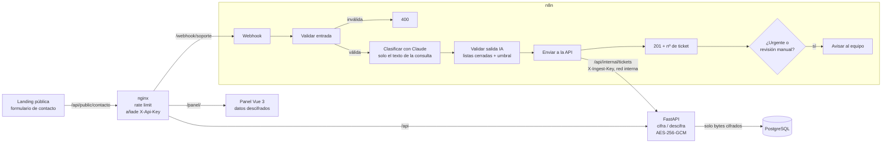

# AtencionCliente-Registro

[](https://github.com/Adrian048/AtencionCliente-Registro/actions/workflows/ci.yml)
[](https://github.com/Adrian048/AtencionCliente-Registro/actions/workflows/security.yml)


**Triage de consultas de clientes con IA** para **Noxum**, una consultora tecnológica ficticia. El
formulario de contacto de su **landing** envía la consulta, un workflow de **n8n** la clasifica con **Claude** (categoría, prioridad,
sentimiento y resumen), la API la **cifra** y la guarda en **PostgreSQL**, y el equipo la
gestiona desde un **panel propio en Vue 3**, el único sitio donde los datos se ven descifrados.


## Cómo funciona

Recorrido completo de una consulta, de la landing al panel. Todas las capturas están en
[`docs/funcionamiento/`](docs/funcionamiento/), numeradas en orden.

### 1. La landing de Noxum

La consultora ficticia **Noxum** presenta sus servicios. Los paneles de la web (estado de la
guardia, despliegue, auditoría, asistente de IA) son fragmentos de interfaz con datos de
ejemplo; el reloj de guardia usa la hora real de Madrid.

| | |
|---|---|
|  |  |
|  |  |
|  |  |
|  |  |
|  |  |
|  |  |

### 2. El cliente envía su consulta

El formulario valida los datos en el navegador y los envía a `/api/public/contacto`. nginx
añade la clave del webhook (el navegador nunca la ve) y los pasa a n8n.

| | |
|---|---|
|  |  |

### 3. También en el móvil

| | | | |
|---|---|---|---|
|  |  |  |  |

### 4. El equipo la gestiona en el panel

n8n valida la consulta, **Claude** la clasifica (categoría, prioridad, sentimiento y
resumen), el código comprueba la respuesta de la IA y la API la **cifra** antes de guardarla.
En el panel, con login, se ve ya clasificada y descifrada. La consulta de las capturas 13 y
14 aparece como **#14: incidencia urgente por phishing**.

| | |
|---|---|
|  |  |
|  | |

## Qué problema resuelve

Antes, alguien tenía que leer cada consulta del formulario de contacto, decidir a qué
equipo le correspondía y si era urgente. Ahora:

- La consulta llega **ya clasificada** en una de 8 categorías: presupuesto, ciberseguridad,
  desarrollo a medida, inteligencia artificial, mantenimiento, incidencia, consulta general
  o spam.
- Las **urgencias** (servicio caído, posible incidente de seguridad) se detectan al momento.
- El **spam** se descarta solo, y lo dudoso va a **revisión manual**.
- Los **datos personales nunca se guardan en claro**: quien acceda a la base de datos o a
  una copia de seguridad solo ve bytes cifrados.

## Arquitectura



| Componente | Tecnología | Función |
|---|---|---|
| `n8n/workflows/` | n8n + Claude (Anthropic) | Recibe, valida y clasifica. No tiene acceso a la base de datos |
| `api/` | Python 3.12, FastAPI, psycopg 3, `cryptography` | Único componente que toca la base de datos: cifra al guardar y descifra para el panel |
| `db/init/` | PostgreSQL 16 | Esquema con columnas cifradas (`BYTEA`), `CHECK` y un rol de mínimo privilegio |
| `panel/` | Vue 3, TypeScript, Vite | Dos páginas: la **landing pública** de Noxum (`/`, HTML y CSS con el formulario de contacto como única pieza Vue, fuente servida desde el propio sitio para cumplir la CSP) y el **panel de gestión** (`/panel/`) con login, filtros, búsqueda y detalle del ticket |
| `panel/nginx.conf` | nginx | Único punto de entrada: sirve ambas páginas, añade la clave del webhook a los envíos del formulario y aplica rate limit |
| `secrets/` | Docker secrets | Un fichero por secreto, montado en `/run/secrets/`. **No hay `.env`** |

## Cifrado de datos de clientes

| Campo | En la base de datos |
|---|---|
| Nombre, apellidos, email, consulta, resumen | **Cifrados** con AES-256-GCM (`BYTEA`) |
| Email (para buscar) | *Blind index*: HMAC-SHA256, permite buscar por email exacto sin poder recuperarlo |
| Categoría, prioridad, estado, sentimiento, confianza | En claro: no son datos personales y el panel filtra por ellos |

- **Una clave maestra de 256 bits** (Docker secret) de la que se derivan con HKDF dos subclaves independientes: una para cifrar y otra para el índice de búsqueda.
- **Nonce aleatorio por valor:** el mismo email cifrado dos veces da resultados distintos, así que no se puede saber si dos clientes coinciden mirando la tabla.
- **El nombre de la columna va como dato asociado (AAD):** un valor cifrado copiado de `email` a `nombre` no se descifra.
- **GCM autentica:** si alguien modifica un byte en la base de datos, la API lo detecta y no muestra datos alterados.
- **Byte de versión** en cada valor, preparado para rotar la clave en el futuro.

Implementación: [`api/src/triage_api/crypto.py`](api/src/triage_api/crypto.py). Un test de integración comprueba contra PostgreSQL real que ningún dato personal aparece en claro en la tabla.

## Decisiones de diseño

| Decisión | Motivo |
|---|---|
| **La IA clasifica, pero el código decide el estado** | Lo que escribe el cliente puede intentar manipular al modelo (*prompt injection*). La salida se valida contra listas cerradas y un umbral de confianza: lo peor que puede conseguir un atacante es que su ticket vaya a revisión manual. |
| **Al modelo solo le llega la consulta** | Minimización de datos (RGPD): el nombre y el email no salen nunca hacia la API de Anthropic. |
| **Cifrado a nivel de campo en la API, no en la base de datos** | La clave nunca llega a PostgreSQL: ni un volcado, ni una copia de seguridad ni un acceso SQL directo revelan datos personales. |
| **n8n no escribe en la base de datos** | Envía el ticket a un endpoint interno de la API, que es la frontera de confianza: valida otra vez, cifra y guarda. n8n no tiene ni credenciales de la base de datos ni la clave de cifrado. |
| **Docker secrets en lugar de `.env`** | Los secretos son ficheros de solo lectura en `/run/secrets/`, solo en los contenedores que los necesitan. No aparecen en variables de entorno ni en `docker inspect`, no están en la imagen ni en el repositorio. |
| **Contraseña del panel hasheada (scrypt), no cifrada** | Una contraseña no tiene que poder recuperarse, ni siquiera por el sistema. |
| **El token de Claude vive en las credenciales de n8n** | n8n las cifra con su propia clave, que también es un Docker secret. |
| **La clave del webhook nunca llega al navegador** | El formulario público llama a `/api/public/contacto` y nginx añade `X-Api-Key` por detrás, leyéndola del Docker secret al arrancar. Cualquier clave o cookie que envíe el cliente se descarta. |
| **Validación en tres capas** | En el navegador (para la experiencia de usuario), en n8n y en la API. Solo las dos últimas cuentan para la seguridad. |
| **Si la IA falla, el ticket no se pierde** | El nodo de IA continúa ante errores y el ticket se guarda en `revision_manual`. |
| **Claude Haiku y `temperature: 0`** | Es una tarea de clasificación: interesa que sea rápida, barata y determinista. |

## Puesta en marcha

Requisitos: Docker, Python 3.12+ y una API key de Anthropic.

```bash
python scripts/generate_secrets.py   # crea ./secrets y te pide la contraseña del panel
docker compose up -d --build
```

Configuración de n8n (solo la primera vez):

1. Abre http://localhost:5678 y crea la cuenta de propietario.
2. Importa el workflow:
   ```bash
   docker compose exec n8n n8n import:workflow --input=/workflows/triage-soporte.json
   ```
3. Crea tres credenciales y asígnalas a sus nodos:
   - **Header Auth** (nodo *Formulario de soporte*): nombre `X-Api-Key`, valor = contenido de `secrets/webhook_api_key`.
   - **Anthropic** (nodo *Claude*): tu API key.
   - **Header Auth** (nodo *Guardar ticket (API cifra)*): nombre `X-Ingest-Key`, valor = contenido de `secrets/triage_ingest_api_key`.
4. Activa el workflow.

Pruébalo:

- **Landing con formulario:** http://127.0.0.1:8080, rellena el formulario del final.
- **Consultas de ejemplo** (incluyen un intento de *prompt injection* y un spam):
  ```bash
  python scripts/send_samples.py
  ```
- **Panel:** http://127.0.0.1:8080/panel/ (usuario `admin` y la contraseña que elegiste).

## Desarrollo local

```bash
# API
cd api && python -m venv .venv && .venv/Scripts/activate   # Linux/macOS: source .venv/bin/activate
pip install -e ".[dev]" && pytest

# Panel
cd panel && npm install && npm run dev    # proxy de /api a localhost:8000
npm test
```

## Tests

- **API (pytest):** cifrado (detección de manipulación, clave incorrecta, valores intercambiados entre columnas), autenticación y bloqueo por intentos, endpoint interno (clave, validación, campos extra), filtros, búsqueda, asignación masiva y cabeceras de seguridad.
- **Integración con PostgreSQL real:** la tabla no contiene ningún dato personal en claro, y el rol de la API no puede borrar ni modificar datos cifrados o la clasificación.
- **Frontend (Vitest):** validación y envío del formulario (sin clave en el navegador, solo los cuatro campos, errores 400/429/red, honeypot y consentimiento), tabla y ventana del mensaje (el texto del cliente nunca se interpreta como HTML).
- **Workflow:** `scripts/check_workflow.py` comprueba la estructura y que no haya credenciales ni secretos incrustados.

## Seguridad

Ver [SECURITY.md](SECURITY.md): controles aplicados según el OWASP Top 10 y el OWASP Top 10 para LLM, con referencia al código o al test que los cubre.

## Próximos pasos

- [ ] Vídeo de demostración del flujo completo
- [ ] Tests E2E con Playwright (login → filtrar → cambiar estado)
- [ ] Rotación de la clave de cifrado (re-cifrado en segundo plano usando el byte de versión)
- [ ] Clave maestra en Azure Key Vault en lugar de fichero
- [ ] Notificación real para urgentes (email o Teams)

## Licencia

[MIT](LICENSE)
